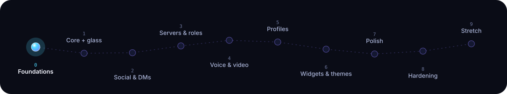
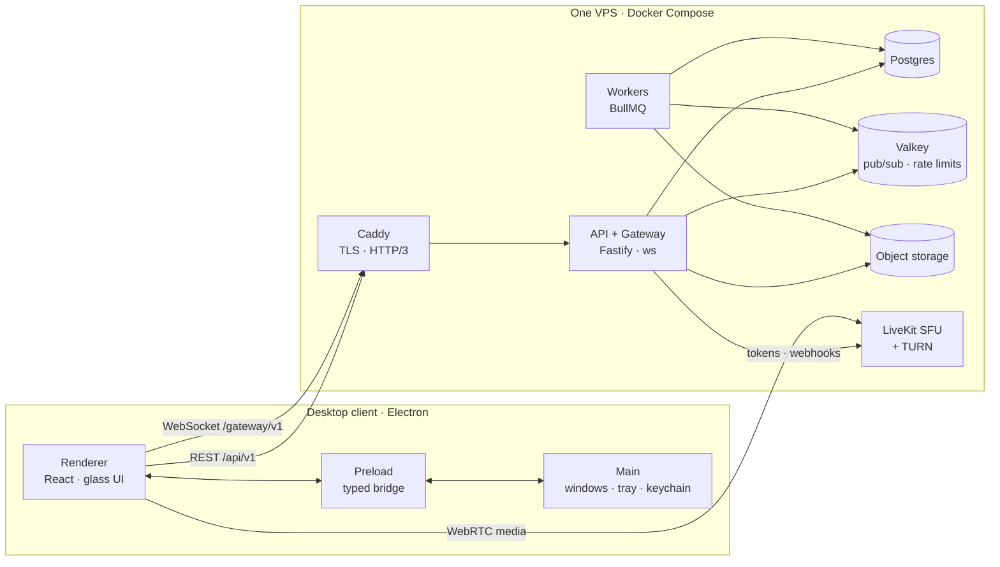

<p align="center">
  <picture>
    <source media="(prefers-color-scheme: light)" srcset="docs/assets/hero-light.svg">
    
  </picture>
</p>

<p align="center">
  <b>A self-hosted, Discord-class place to talk.</b><br>
  Servers, roles, DMs, voice, video and screen share, on one VPS you own, behind a desktop client made of light and glass.
</p>

<p align="center">
  
  
  
  
  
  
</p>

---

> [!NOTE]
> SilverCord is being built in the open, phase by phase. Phase 1 delivers accounts, TOTP,
> a resumable gateway and the glass design system in a hardened desktop client.
> Phase 2 adds friends and messaging. The roadmap shows where it is.

## Why another chat app

Most communities live on someone else's server. SilverCord is for the ones that would
rather not: a private group of up to a few hundred people, one operator, one
reasonably sized VPS, and an app that feels better to use than the big platforms.

<table>
  <tr>
    <td width="25%" valign="top">
      <h3>Talk</h3>
      Voice channels that stay connected while you browse. DM and group calls with
      ringing, camera, screen share with system audio, push-to-talk, per-person
      volume. Built on a LiveKit SFU, not a hand-rolled one.
    </td>
    <td width="25%" valign="top">
      <h3>Gather</h3>
      Servers with categories, channels, threads and pins. Roles and channel overrides
      resolved by a pure, property-tested permission engine. Two layouts: chat-first,
      or a dense TeamSpeak-style tree.
    </td>
    <td width="25%" valign="top">
      <h3>Express</h3>
      Profiles with banners, pronouns, badges and live activity. Custom emotes and
      stickers. A grid of declarative profile widgets you arrange yourself: clocks,
      galleries, now playing, pixel art.
    </td>
    <td width="25%" valign="top">
      <h3>Own it</h3>
      One <code>docker compose</code> stack: Postgres, Valkey, LiveKit, Caddy with
      automatic TLS. Nightly encrypted backups with a restore drill that actually
      gets run. Export or delete your data any time.
    </td>
  </tr>
</table>

## Liquid glass, on purpose

The client is designed around two layers: a calm, legible **content layer** for
messages, and a floating **glass layer** for everything you navigate with. Glass needs
something to refract, so the app paints its own slow aurora behind everything. It
looks the same on Windows 11, Windows 10, X11 and Wayland.

| Tier | What you get |
|---|---|
| **High** | Blur, tint, pointer-following specular rim, grain, and real SVG displacement refraction on small floating controls |
| **Low** | Blur, tint and rim; no refraction |
| **Solid** | Opaque themed surfaces; used automatically with `prefers-reduced-transparency` |
| **Auto** | A frame-time governor moves between tiers so the UI never drops below 60 fps |

Springs instead of easing curves, server icons that morph from squircle to circle,
indicators that stretch toward where they're going. Reduced motion is respected
everywhere, and a motion-intensity slider turns it all down.

## Roadmap

<p align="center">
  
</p>

| Phase | Ships | Done when |
|---|---|---|
| 0 | Monorepo, hooks, CI, dev stack, empty hardened window | Fresh clone boots server + window; verify green |
| 1 | Auth, gateway, Electron hardening, glass design system | Sign up, log in, live gateway; glass renders in every tier |
| 2 | Friends, DMs, messages, uploads, first VPS deploy | Two machines chat through the VPS; 60 fps on 10k messages |
| 3 | Servers, roles, permission engine, moderation | Permission matrix green; invite flow end to end |
| 4 | Voice, video, calls, screen share | Stable 4-person call across networks |
| 5 | Profiles, badges, activity, emotes, GIFs | Privacy toggles enforced server-side |
| 6 | Profile widgets, theme editor | Malicious widget JSON rejected by tests |
| 7 | Search, settings, installers, auto-update | Clean install on Windows 11 and Wayland |
| 8 | Security audit, load tests, restore drill | 2k sockets in budget; no high findings open |
| 9 | Bots, E2EE, stage and forum channels | Stretch |

The living checklist is in [`docs/PLAN.md`](docs/PLAN.md); the handoff log is in
[`docs/PROGRESS.md`](docs/PROGRESS.md).

## Architecture



Contracts live in one place: Zod schemas in `packages/protocol` produce the TypeScript
types, the runtime validation on both sides, and the OpenAPI document. The client and
server can't drift apart.

## Run it locally

Requirements: Node 24 LTS, pnpm 11, Docker with Compose.

```sh
pnpm i            # installs everything, including the Electron binary
pnpm dev:stack    # Postgres, Valkey, LiveKit (dev), Mailpit
pnpm dev          # API on :4000 and the desktop client
```

| Command | Does |
|---|---|
| `pnpm verify` | Biome, typecheck and unit tests for affected packages |
| `pnpm verify:full` | Everything above plus integration and Electron end-to-end tests |
| `pnpm ui:shots` | Screenshots of key screens in every theme and tier |
| `pnpm db:migrate` | Apply database migrations |

## Repository map

```
apps/
  server/        REST API, WebSocket gateway, workers
  desktop/       Electron main, preload and React renderer
packages/
  protocol/      Zod schemas, gateway opcodes, brand constants
  permissions/   pure bigint permission engine
  markdown/      chat markdown → AST (never HTML strings)
  ui/            glass design system and themes
  widgets/       profile widget schema and renderers
  config/        shared TypeScript presets
infra/           Compose stacks, Caddy, LiveKit, backup and deploy scripts
docs/            brief, plan, ADRs, specs, runbook
```

## Contributing

Every commit follows one rule, enforced by a hook and again in CI:

```
<gitmoji> <scope>: <imperative subject>

✨ gateway: support session resume with sequence replay
🛂 permissions: implement channel overwrite resolution
💫 ui: spring squircle morph on server icon hover
```

Decisions are written down before they're coded: see [`docs/adr/`](docs/adr/) and
[`docs/spec/`](docs/spec/). Platform limitations are listed honestly in
[`docs/PLATFORM-LIMITS.md`](docs/PLATFORM-LIMITS.md).

## License

Proprietary. All rights reserved.
